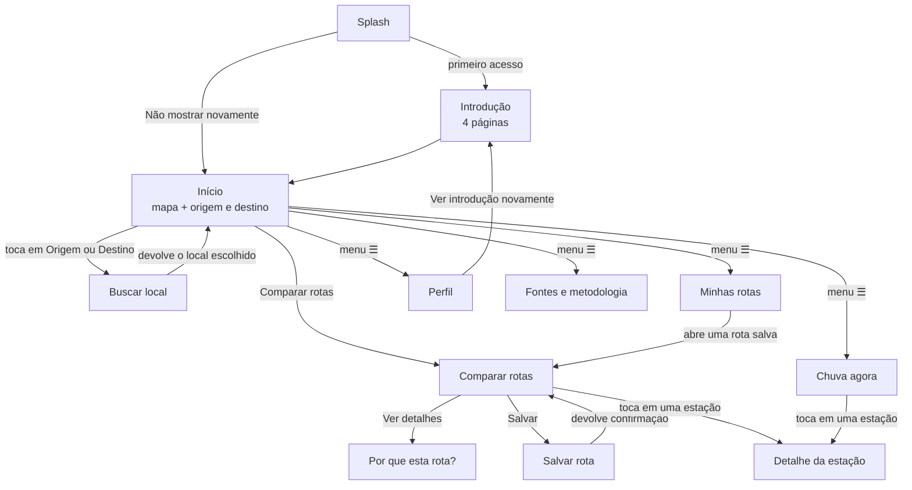
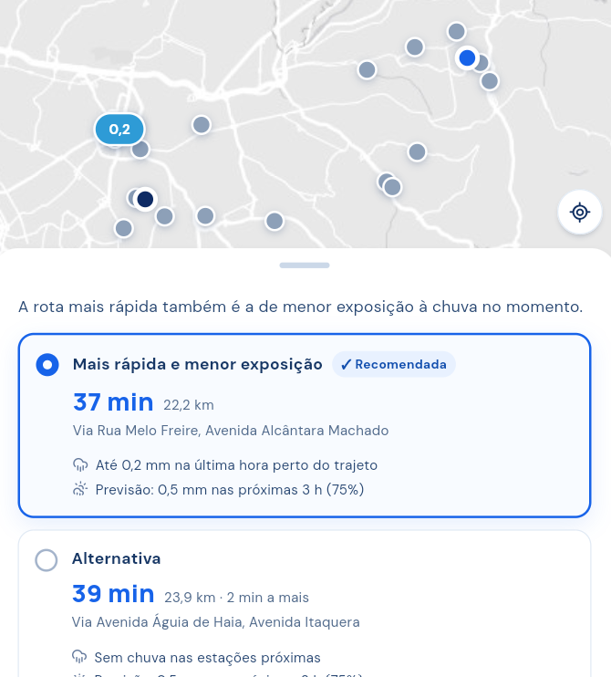
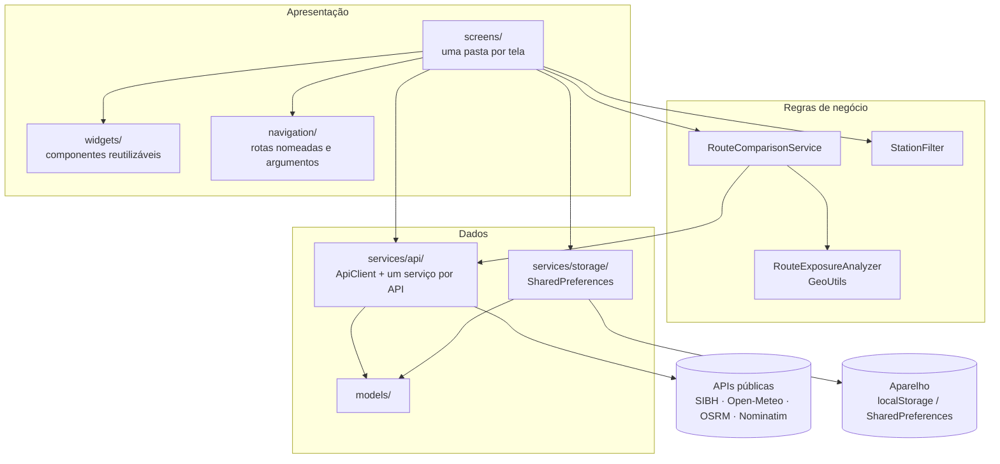

# Rota Segura (Flutter)

### Integrantes

- David dos Santos Lima RM555441
- Enzo Francisco Luchini RM557710
- Raphael Costa de Souza RM559024

## Tema da Global Solution

**Global Solution 2026.2 — CitizenTech** (3º ano de Sistemas de Informação, FIAP).

O desafio pede uma solução tecnológica que parta de um problema real do cidadão e gere uma melhoria concreta na vida das pessoas, nas cidades, no campo ou nas comunidades. Entre as sugestões do briefing estão rotas urbanas que consideram diferentes condições de mobilidade e sistemas de previsão de enchentes com alertas para a população.

O Rota Segura responde a esse desafio no tema **mobilidade urbana e clima**: em São Paulo, a chuva forte causa alagamentos, congestionamentos e riscos para quem está no trânsito, e o motorista quase nunca sabe, antes de sair, por qual caminho está chovendo.

**ODS relacionados**

| ODS | Contribuição |
|---|---|
| **ODS 11** — Cidades e comunidades sustentáveis | Deslocamentos mais seguros e informados com dados públicos da própria cidade. |
| **ODS 13** — Ação contra a mudança global do clima | Ajuda o cidadão a se adaptar a eventos de chuva intensa, cada vez mais frequentes. |
| **ODS 9** — Indústria, inovação e infraestrutura | Reaproveita dados abertos (rede de pluviômetros, OpenStreetMap) para criar um serviço novo. |

## Descrição da solução

O Rota Segura é um aplicativo que **compara rotas de carro em São Paulo pela exposição à chuva**. O usuário informa a origem e o destino, e o app busca até três alternativas de trajeto e mostra, para cada uma:

- o tempo estimado e a distância;
- as principais vias do caminho;
- a **chuva registrada na última hora** nas estações pluviométricas perto do trajeto;
- a **previsão de chuva** para as próximas horas ao longo da rota.

Com esses dados, o app recomenda a rota de menor exposição à chuva e explica o motivo na tela "Por que esta rota?". Quando a diferença entre as rotas é pequena (menos de 0,5 mm), vale a mais rápida.

Além da comparação, o app mostra a **chuva agora em cada estação da cidade**, com busca, filtros e favoritos, e permite **salvar rotas frequentes** no próprio aparelho para consultá-las de novo com um toque.

**Público:** motoristas, motociclistas e motoristas de aplicativo que circulam por São Paulo e querem decidir o caminho antes de sair em dias de chuva.

**Diferenciais**

- Usa a **chuva medida de verdade** pelas estações da rede SIBH / SP Águas, não só a previsão.
- Explica a recomendação em linguagem simples, sem esconder os limites dos dados.
- Funciona sem cadastro, sem chave de API e sem servidor próprio; os dados do usuário ficam só no aparelho.

É a versão mobile em Flutter do projeto web [Rota Segura](https://github.com/EnzoLuchini/Rota-segura).

## Fluxo de telas



1. **Splash** mostra o logo e decide, pelo SharedPreferences, se abre a introdução ou o Início.
2. **Introdução** apresenta o app em 4 páginas, com a opção "Não mostrar novamente".
3. **Início** traz o mapa com as estações com chuva, os campos de origem e destino e um resumo da chuva agora.
4. **Buscar local** procura endereços dentro de São Paulo e devolve o local escolhido para o Início.
5. **Comparar rotas** desenha as alternativas no mapa e mostra tempo, distância e exposição à chuva de cada uma.
6. **Por que esta rota?** detalha os fatores da recomendação (chuva observada, previsão e estações próximas).
7. **Salvar rota** dá um nome ao trajeto e o guarda no aparelho.
8. **Chuva agora** lista todas as estações da cidade, com busca, filtros (Todas / Com chuva / Favoritas) e "puxar para atualizar".
9. **Detalhe da estação** mostra a leitura atual, a previsão das próximas horas e o botão de favoritar.
10. **Minhas rotas** lista as rotas salvas para consultar ou excluir.
11. **Perfil** reúne as preferências (raio das estações, estações sem chuva no mapa, introdução) e a opção de apagar os dados locais.
12. **Fontes** explica de onde vêm os dados, os limites de cada fonte e a metodologia da comparação.

O menu ☰ leva às seções principais e mantém o Início na base da pilha de navegação.

## Prints das telas

As imagens ficam em [`docs/prints/`](docs/prints).

| | | |
|:---:|:---:|:---:|
| <br/>**Splash** | <br/>**Introdução** | <br/>**Início** |
| <br/>**Buscar local** | <br/>**Comparar rotas** | <br/>**Por que esta rota?** |
| <br/>**Salvar rota** | <br/>**Chuva agora** | <br/>**Detalhe da estação** |
| <br/>**Minhas rotas** | <br/>**Perfil** | <br/>**Fontes** |

## API utilizada

O app consome **APIs REST públicas** com o pacote `http`. Todas são gratuitas, **não pedem chave** e **aceitam chamadas do navegador (CORS)**, por isso funcionam no Chrome sem servidor intermediário.

| API | Endpoint | Uso no app |
|---|---|---|
| **SIBH / SP Águas — "Chuva Agora"** | `GET https://apps.spaguas.sp.gov.br/sibh/api/v2/measurements/now` | Chuva acumulada na última hora em cada estação pluviométrica, filtrada pelo município de São Paulo (código IBGE 3550308). |
| **Open-Meteo** | `GET https://api.open-meteo.com/v1/forecast` | Previsão horária de chuva (`precipitation` e `precipitation_probability`) em vários pontos de uma vez, no fuso `America/Sao_Paulo`. |
| **OSRM (OpenStreetMap)** | `GET https://router.project-osrm.org/route/v1/driving/{origem};{destino}` | Até 3 rotas de carro alternativas, com geometria GeoJSON, distância, duração e vias principais. |
| **Nominatim (OpenStreetMap)** | `GET https://nominatim.openstreetmap.org/search` | Busca de endereços em português, limitada à área do município de São Paulo. |
| **Esri World Light Gray** | Tiles `server.arcgisonline.com/.../World_Light_Gray_Base/MapServer/tile/{z}/{y}/{x}` | Mapa base cinza claro exibido com o `flutter_map`. |

Cada resposta JSON é convertida em um modelo próprio (`RainStation.fromJson`, `RainForecast.fromJson`, `DrivingRoute.fromOsrm`, `Place.fromNominatim`). O [`ApiClient`](lib/services/api/api_client.dart) aplica tempo limite e transforma falhas de rede em mensagens amigáveis. Se as estações ou a previsão falharem, a comparação continua só com as rotas, sem travar o app.

O GeoSampa e o feed do INMET, usados pelo backend Node da versão web, não respondem a chamadas feitas direto do navegador, então ficaram de fora desta versão.

## Explicação da arquitetura

O app segue uma **arquitetura em camadas**: as telas não falam direto com as APIs nem guardam regras de negócio. Cada camada só conhece a camada de baixo.



**Camadas**

- **Apresentação** (`screens/`, `widgets/`, `navigation/`, `theme/`): telas em `StatefulWidget` com estado em `setState`, e componentes estáticos em `StatelessWidget`. A navegação usa rotas nomeadas geradas em `onGenerateRoute` com argumentos tipados. Cada tela que carrega dados passa pelos estados `initial / loading / success / error`, sempre com "Tentar novamente".
- **Regras de negócio** (`services/analysis/`, `services/route_comparison_service.dart`, `services/station_filter.dart`): ficam fora das telas e são testadas isoladamente.
- **Dados** (`services/api/`, `services/storage/`, `models/`): um serviço por API externa, um armazenamento por tipo de dado local e modelos imutáveis com construtores `fromJson`.

**Como a comparação de rotas funciona**

1. O `RouteComparisonService` pede as rotas ao OSRM e, em paralelo, as estações ao SIBH.
2. Para cada rota, sorteia 4 pontos ao longo do trajeto e pede a previsão das próximas horas ao Open-Meteo em uma única chamada.
3. O `RouteExposureAnalyzer` procura as estações com leitura recente a até 1, 2 ou 3 km do trajeto (ajuste no Perfil) e pega a maior chuva da última hora.
4. A exposição de cada rota é a soma da chuva observada com a maior previsão acumulada. A recomendada é a de menor exposição; se a diferença for menor que 0,5 mm, vale a mais rápida.

**Tecnologias**

| Tecnologia | Uso |
|---|---|
| Flutter / Dart | Aplicativo multiplataforma (alvo principal: Chrome em formato de celular) |
| `http` | Chamadas REST às APIs públicas |
| `flutter_map` + `latlong2` | Mapa, rotas desenhadas e marcadores das estações |
| `shared_preferences` | Introdução, favoritos, rotas salvas e preferências no aparelho |
| `lucide_icons_flutter` | Ícones |
| `flutter_test` + `flutter_lints` | Testes automatizados e análise estática |

**Estrutura de pastas**

```
lib/
  config/        URLs das APIs e limites de São Paulo
  theme/         cores e tipografia (Manrope + DM Sans em assets/fonts)
  navigation/    rotas nomeadas, router, argumentos tipados e observer
  data/          conteúdo estático: introdução, sugestões de busca, fontes
  models/        estação, previsão, rota, análise, local, rota salva, preferências, estados
  services/api/  cliente HTTP e um serviço por API
  services/analysis/  geometria e comparação das rotas
  services/storage/   SharedPreferences: introdução, favoritos, rotas salvas, preferências
  utils/         formatação em português (mm, horário de Brasília, minutos)
  widgets/       componentes reutilizáveis: moldura, cabeçalho, mapa, cartões, estados
  screens/       uma pasta por tela
```

## Como rodar no Chrome (aba vertical)

Requer o Flutter 3.47 ou mais recente.

```bash
flutter pub get
```

```bash
flutter run -d chrome --web-port=8080 --web-browser-flag=--window-size=440,956
```

A janela do Chrome abre em formato de celular (440 × 956). A porta fixa (`--web-port=8080`) é necessária para que as preferências, os favoritos e as rotas salvas continuem entre uma execução e outra: no navegador, o SharedPreferences grava no `localStorage`, que é separado por endereço e porta. Para que o Flutter guarde esses dados, feche o app com `q` no terminal ou fechando a janela do Chrome.

Também há configurações prontas: **"Chrome (aba vertical)"** no Android Studio (`.idea/runConfigurations`) e **"Rota Segura (Chrome, aba vertical)"** no VS Code (`.vscode/launch.json`).

Em uma aba larga, o app aparece centralizado em uma moldura de celular. Em uma aba estreita (ou no modo dispositivo do DevTools, `Ctrl+Shift+M`), ocupa a tela toda.

> **Caminho com `°` no Windows.** O `flutter analyze` pode falhar quando a pasta tem caracteres como `°` (`3° ano`). Crie uma junção para um caminho só com ASCII e rode os comandos a partir dela:
> `New-Item -ItemType Junction -Path C:\dev\rota_segura -Target "<pasta do projeto>"`

## Testes

```bash
flutter analyze
```

```bash
flutter test
```

26 testes cobrem a conversão dos JSON em modelos, a análise de exposição das rotas, os filtros, os formatadores, o Splash, a introdução e a lista de estações passando pelos quatro estados.

## Requisitos da disciplina

| Requisito | Onde está |
|---|---|
| **1. Splash** | [splash_screen.dart](lib/screens/splash/splash_screen.dart) mostra o logo e, depois de 1,8 s, lê o SharedPreferences ([onboarding_storage.dart](lib/services/storage/onboarding_storage.dart)) e segue para a introdução ou para o Início. |
| **2. Onboarding** | [onboarding_screen.dart](lib/screens/onboarding/onboarding_screen.dart): 4 páginas ([onboarding_pages.dart](lib/data/onboarding_pages.dart)) com ícone, título e descrição; botões Voltar, Avançar/Começar e Pular; caixa "Não mostrar novamente", salva ao concluir. O Perfil tem "Ver introdução novamente" e uma chave para voltar a mostrá-la. |
| **3. Navegação** | Rotas nomeadas ([app_routes.dart](lib/navigation/app_routes.dart)) criadas em `onGenerateRoute` ([app_router.dart](lib/navigation/app_router.dart)), com argumentos tipados ([route_args.dart](lib/navigation/route_args.dart)). Parâmetros: origem/destino → comparação; rota → detalhe; estação → detalhe. A busca de local e "Salvar rota" devolvem resultado no `pop`. |
| **4. WebService** | Pacote `http` em [api_client.dart](lib/services/api/api_client.dart), com tempo limite e mensagens amigáveis. O JSON vira modelos. Estados `initial/loading/success/error` ([load_status.dart](lib/models/load_status.dart)) em Chuva agora, Detalhe da estação, Buscar local, Comparar rotas e no resumo do Início. |
| **5. Interações** | Item da lista → detalhe (estações e rotas). Busca sem acentos e filtros. Favoritar estações. Atualizar (botão e "puxar para atualizar"). Selecionar rota, fatores expansíveis, trocar e limpar origem e destino, salvar e excluir rotas frequentes, preferências. |
| **6. Organização e estado** | Estado com `setState` em `StatefulWidget`; componentes estáticos em `StatelessWidget`. Regras fora das telas: [route_exposure_analyzer.dart](lib/services/analysis/route_exposure_analyzer.dart), [station_filter.dart](lib/services/station_filter.dart), [saved_routes_storage.dart](lib/services/storage/saved_routes_storage.dart). Ao voltar para o Início, um `RouteObserver` recarrega as preferências alteradas no Perfil. |

## Limites

Chuva registrada não é o mesmo que alagamento, e a ausência de chuva não garante que a via esteja livre. O tempo das rotas não considera o trânsito do momento. Não há alertas em tempo real, notificações nem navegação por GPS.
